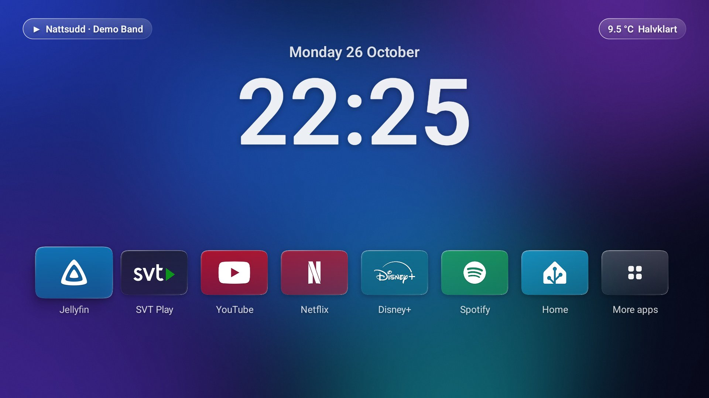
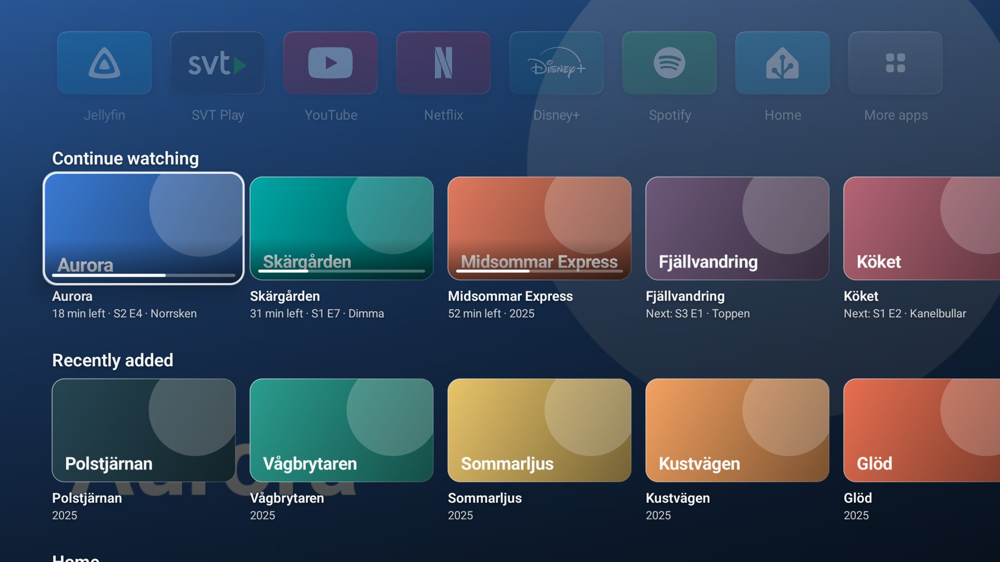
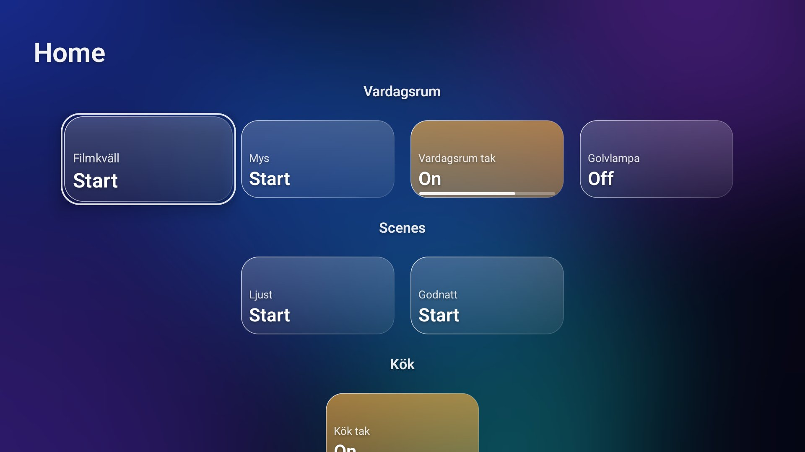
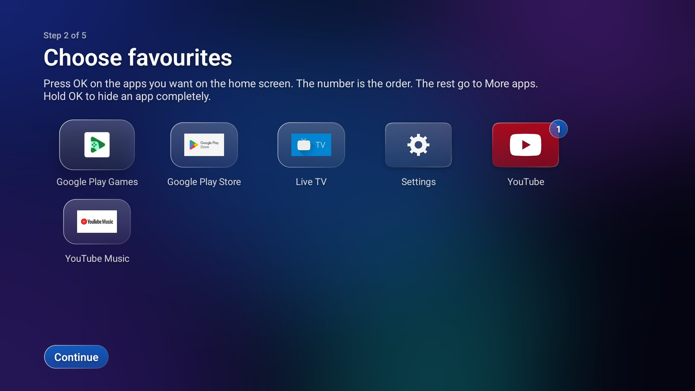
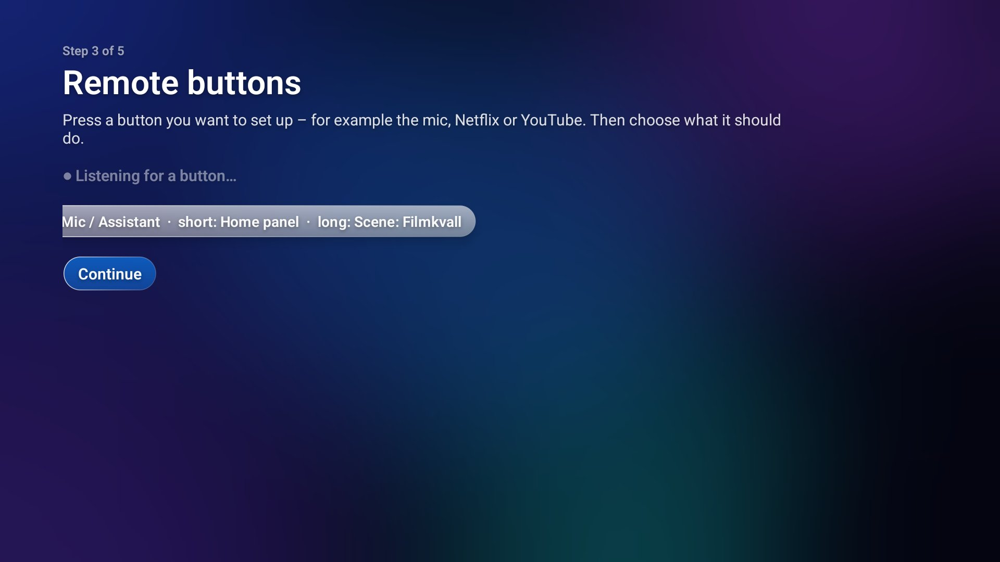

# Glass Home

A home screen for **Chromecast with Google TV** and **Google TV Streamer**, in the style of iOS 26 "Liquid Glass". No ads, no
recommendations: just your apps, a big clock, your films and your home.



| Press down: Continue watching + Recently added | Home Assistant panel |
|---|---|
|  |  |

| First-run setup: pick favourites | Teach it your remote's buttons |
|---|---|
|  |  |

Screenshots are from demo mode (fake data) on the built-in wallpaper.

## Features

- **Calm by default:** clock, date and your favourite apps. Press **down** and the clock moves aside for more rows.
- **Smooth motion:** spring physics everywhere, Apple TV-style card lift (tilt, light sheen, shadow), fixed-focus scrolling,
  wallpaper parallax, panels that zoom out of the button you pressed, rolling clock digits.
- **First-run setup on the TV:** choose and order favourites from all installed apps (the rest go to "More apps", or hide them),
  teach it what remote buttons do (mic, Netflix, YouTube… → open an app, a panel, a Home Assistant scene, play/pause; separate
  short and long press), choose a wallpaper.
- **Jellyfin:** "Continue watching" and "Recently added" rows. The background turns into the film's backdrop while you browse.
  Switch Jellyfin profile per household member.
- **Home Assistant:** scenes and lights grouped by room, updated live over the WebSocket API. Hold a light for brightness (◀ ▶).
  Weather in the corner, "now playing" from any media player, and notifications from automations (see below).
- **Wallpapers:** a built-in glass gradient, or macOS Sierra / Tahoe / Tahoe beach that follows the time of day, downloaded on
  the TV from 512pixels.net when chosen (not bundled).
- **Screensaver:** the big clock over a slow Ken Burns pan through your Jellyfin backdrops.
- **Set up from your phone:** the TV shows a QR code to a small form for the Home Assistant / Jellyfin connection (LAN only,
  random port + PIN, runs only while that screen is open).
- **Updates itself:** when a new release is published here, the home screen shows "New version", with the release notes.
- Long-press any card: move it (it wiggles; ◀ ▶), remove, hide. Languages: Swedish and English, following the TV.

## Install

You need a Windows PC on the same network as the TV.

1. On the TV: **Settings → System → About**, click **Android TV OS build** 7 times. Then **Settings → System → Developer options**:
   turn on **USB debugging** and **Wireless debugging**, open Wireless debugging → **Pair device with pairing code**.
2. Download **glass-home-share.zip** from the newest [release](../../releases), unzip it, double-click **install-glass-home.bat**
   and type what the TV shows.
3. Press **Home**. The setup guide starts.

`uninstall-glass-home.bat` brings the normal Google TV home screen back.

The installer disables the Google TV launcher (plus the setup helper that would re-enable it), makes Glass Home the home app,
enables its button service and screensaver, and lets it install its own updates. Cast and everything else keep working.

## Home Assistant notifications

Any automation can pop up a glass notification on the TV:

```yaml
action: event.fire          # or in the UI: "Fire event"
data:
  event_type: glass_home_notify
  event_data:
    title: Washing machine
    message: The laundry is done
```

## Build

Plain Java, no Gradle or AndroidX. Needs JDK 17, Android SDK build-tools 35.0.0 + platform android-35
(default `%USERPROFILE%\Android\sdk`, override with `GLASS_SDK`), Python 3 with Pillow, numpy, svgelements. In Git Bash:

```bash
python artwork/fetch_logos.py [dir with app APKs]   # brand logos (Simple Icons; APK images for the rest)
python artwork/make_assets.py                       # glass buttons + gradient wallpaper
bash build.sh                                       # → glass-home.apk (LINT=1: warnings are errors)
bash build.sh --install <device>                    # also installs + makes it the home app
bash make-share.sh                                  # → share/ + glass-home-share.zip
```

| Path | What |
|---|---|
| `src/se/glass/home/MainActivity.java` | home screen, panels, menus, move mode |
| `HomeView`, `RowView`, `CardView`, `Motion`, `RollingClock` | layout, fixed-focus rows, card lift, springs |
| `SetupActivity`, `Settings`, `Apps` | first-run wizard, on-TV settings, app scanning |
| `KeyService` | remote-button remapping (accessibility service) |
| `HomeAssistant`, `HaLive`, `Tiles` | REST + live WebSocket client, tiles |
| `Jellyfin`, `Poster`, `Cache` | rows, artwork, offline cache |
| `Wallpapers`, `Blur`, `GlassDream` | wallpapers, frosted panels, screensaver |
| `PhoneSetup`, `Qr` | phone setup page + QR code |
| `Updater`, `InstallReceiver` | self-update from GitHub releases |
| `Demo` | demo mode (`Home screen → Demo mode`) |

Every push to `main` builds a release (`.github/workflows/release.yml`); pull requests get a build check. Releases are signed with
the key in the `KEYSTORE_B64` secret so they install over earlier versions.

Brand logos are trademarks of their owners and are used only to label the apps you already have installed. macOS wallpapers are
© Apple and are never included in this repo or the APK.
